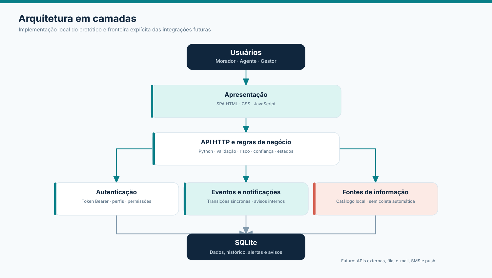
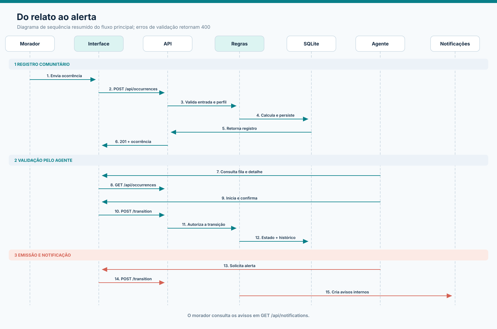
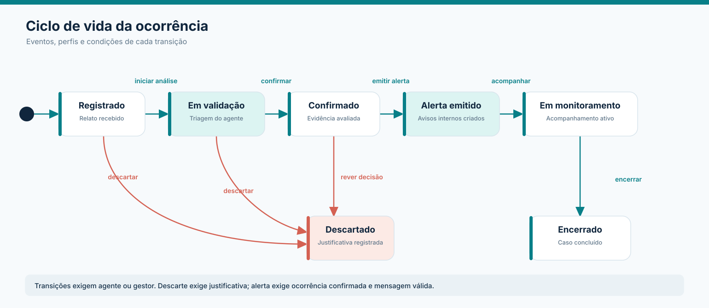

# Arquitetura do AlertaBairro

## Visão geral

O protótipo é uma aplicação web local em camadas. Um servidor Python entrega os arquivos estáticos da interface e expõe uma API JSON em `/api`. O SQLite mantém os registros entre execuções. O processamento das mudanças de estado e das notificações ocorre na mesma requisição HTTP.

Fontes editáveis: [Mermaid](diagramas/arquitetura.mmd). Os diagramas de [sequência](diagramas/sequencia.mmd) e [estados](diagramas/estados.mmd) também têm versões PlantUML na mesma pasta.

## Camadas implementadas

| Camada | Responsabilidade no protótipo | Comunicação |
| --- | --- | --- |
| Apresentação | SPA em HTML, CSS e JavaScript; dashboard, mapa e fluxos de morador/agente/gestor | Requisições `fetch` para `/api`; token Bearer |
| Aplicação e regras de negócio | Validação de entradas; cálculo de risco/confiança; autorização; transições permitidas | Chamadas internas no servidor Python |
| Persistência e dados | Usuários, ocorrências, histórico de estados, alertas e notificações | SQLite com arquivo local configurável |
| Fontes externas | Catálogo/identificação de origens exibido na interface; dados demonstrativos | Sem coleta automática de serviços externos nesta versão |
| Processamento de eventos | Reação síncrona a registro e transição; atualização do histórico | Dentro da requisição HTTP, com escrita no SQLite |
| Serviço de notificações | Geração e leitura de avisos **internos** após emissão de alerta | Tabelas SQLite e endpoints da API |
| Autenticação e proteção de dados | Login local; token de acesso; perfis e autorização no servidor | Cabeçalho `Authorization: Bearer ...` |

## Fluxo de dados

1. O usuário entra com credenciais locais. A API identifica perfil e autoriza as ações em cada rota protegida.
2. O morador preenche uma ocorrência. A API valida dados, calcula risco e confiança e persiste o registro em `Registrado`.
3. O agente consulta a fila, lê o detalhe e muda o estado. A API verifica perfil, estado atual e condições da transição antes de escrever o novo estado e o histórico.
4. Ao emitir um alerta de ocorrência confirmada, a aplicação persiste o alerta e as notificações internas associadas.
5. O painel consulta a API, portanto seus números acompanham os registros salvos no SQLite.

Arquivos editáveis: [Mermaid](diagramas/sequencia.mmd) · [PlantUML](diagramas/sequencia.puml).

## Máquina de estados

Arquivos editáveis: [Mermaid](diagramas/estados.mmd) · [PlantUML](diagramas/estados.puml).

| Origem | Evento | Condição | Destino | Efeito |
| --- | --- | --- | --- | --- |
| Novo relato | Enviar ocorrência | Campos válidos; usuário autenticado | Registrado | Persistir e calcular indicadores |
| Registrado | Iniciar análise | Agente ou gestor | Em validação | Registrar responsável e histórico |
| Registrado | Descartar | Agente ou gestor; justificativa | Descartado | Registrar motivo |
| Em validação | Confirmar | Agente ou gestor; decisão humana | Confirmado | Registrar decisão; recalcular confiança |
| Em validação | Descartar | Agente ou gestor; justificativa com 8+ caracteres | Descartado | Registrar motivo |
| Confirmado | Rever e descartar | Agente ou gestor; justificativa com 8+ caracteres | Descartado | Registrar revisão |
| Confirmado | Emitir alerta | Agente ou gestor; mensagem com 20–500 caracteres | Alerta emitido | Criar alerta e notificações internas |
| Alerta emitido | Iniciar acompanhamento | Agente ou gestor | Em monitoramento | Registrar monitoramento |
| Em monitoramento | Encerrar | Agente ou gestor | Encerrado | Registrar fechamento |

`Descartado` e `Encerrado` terminam o fluxo demonstrativo. Uma transição fora da tabela é rejeitada pela API.

## Regras de pontuação

**Risco:** `min(100, base_do_tipo + gravidade × 8 + min(20, pessoas_afetadas × 2))`. As bases são: Deslizamento 45; Incêndio 40; Alagamento e Queda de árvore 25; Falta de energia 15; Outro 10. Pontuações até 34 são `Baixo`, até 59 `Moderado`, até 79 `Alto` e a partir de 80 `Crítico`. O número orienta a triagem do protótipo; o agente ainda precisa validar o relato.

**Confiança:** `min(100, base_da_origem + bônus_de_evidências + bônus_de_corroborizações + recência + verificação)`. A base é 35 para relato comunitário, 60 para fonte externa e 85 para fonte oficial. Evidências somam até 15 pontos; corroborações, até 20; recência, 10 até 24 horas, 5 até 72 horas e 0 depois; confirmação por agente acrescenta 20. A confiança é separada do risco: um evento pode ser grave e ainda ter pouca evidência. É uma heurística, não uma probabilidade de veracidade.

## Segurança e privacidade

- Permissões são aplicadas na API, além da visibilidade de ações na interface. Apenas agente e gestor podem fazer transições; a lista de usuários é restrita ao gestor.
- Senhas locais são derivadas com PBKDF2-SHA256 e salt individual. A tabela de sessões armazena o hash do token, com expiração de 12 horas; a API oferece logout.
- O repositório ignora o banco SQLite local e arquivos de ambiente com valores próprios.
- Os usuários de demonstração são fictícios. Não utilize dados pessoais reais ou este conjunto de credenciais em produção.
- A aplicação deve ser executada em ambiente de desenvolvimento. Publicação externa exigiria revisão de sessão, transporte HTTPS, limites de requisição e política de retenção de dados.

## Evoluções futuras, fora do escopo implementado

| Evolução possível | Motivo |
| --- | --- |
| Integração com Defesa Civil, meteorologia e sensores | Cruzar relatos com fontes institucionais e automáticas |
| Filas e trabalhadores assíncronos | Processar picos de eventos sem depender da resposta HTTP |
| Envio por e-mail, SMS ou push | Ampliar o alcance das notificações além da interface |
| Geocodificação e mapas cartográficos | Melhorar a visualização espacial e a precisão de endereços |
| SSO, MFA, renovação de sessão e auditoria ampliada | Endurecer o acesso em uma implantação real |
| PostgreSQL e observabilidade | Escalar armazenamento, métricas, logs e operação multiusuário |
| Moderação e contestação de relatos | Permitir revisão formal de decisões e reabertura controlada |

Essas ideias descrevem caminhos de evolução; não são apresentadas como recursos disponíveis no protótipo.
