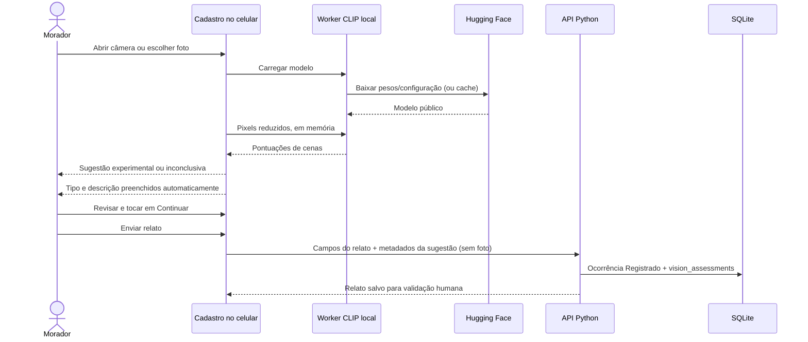

# Assistente de imagem e câmera

## Como usar

1. Entre no app e abra **Registrar**. Na primeira etapa, toque em **Abrir câmera com IA**.
2. Autorize a câmera traseira. A primeira execução baixa aproximadamente **180 MB** entre runtime, pesos e configuração; prefira Wi-Fi. O progresso é mostrado por arquivo.
3. Aponte para a situação de uma posição segura. O app analisa uma imagem por vez e espera três segundos entre análises; não promete uma taxa fixa de quadros por segundo.
4. Quando duas análises consecutivas identificam a mesma categoria, o tipo é preenchido automaticamente e a câmera é pausada. A IA também cria uma descrição inicial editável, sem substituir texto escrito pelo usuário. Por exemplo, a casa em chamas resulta em **Classificação da IA: Incêndio**. Em foto, basta uma análise conclusiva. Se o usuário já escolheu um tipo manualmente, ele é preservado e o botão **Aplicar este resultado** permite substituí-lo.
5. Confira o tipo e a descrição e toque em **Continuar** para confirmar o rascunho. Informe o bairro/local e envie normalmente. A ocorrência começa como **Registrado** e depende da validação do agente para gerar alerta.

Também há **Tirar ou escolher foto** para uma análise única. JPG, PNG e WebP de até 12 MB são aceitos; a decodificação admite até 40 megapixels. A imagem é reduzida a no máximo 640 pixels no lado maior antes de ir ao worker. O formulário manual funciona sem câmera ou IA.

## Modelo realmente implementado

- Classificação de cenas **CLIP ViT-B/32**, pesos ONNX quantizados q8: [`Xenova/clip-vit-base-patch32`](https://huggingface.co/Xenova/clip-vit-base-patch32).
- Revisão fixa: `6b7c523703ae26e39be4b03774966f8571c7f523`; pesos `model_quantized.onnx` com 153.695.702 bytes. Os pesos são baixados do Hugging Face sob demanda e podem ser reutilizados pelo cache do navegador; não são enviados ao GitHub com o app.
- [Transformers.js 3.8.1](https://huggingface.co/docs/transformers.js/v3.8.1/en/index) e ONNX Runtime Web `1.22.0-dev.20250409-89f8206ba4`, incluídos localmente em `frontend/vendor/transformers` com licenças. Runtime WASM de aproximadamente 22 MB, carregado somente quando a IA é usada. Não há chave de API, serviço pago ou inferência em nuvem.
- Inferência em **Web Worker + WASM**, uma thread, sem necessidade de WebGPU ou isolamento entre origens. A interface continua disponível durante a análise.

O modelo compara a imagem com onze descrições em inglês: quatro eventos suportados e sete alternativas de contexto comum/imagem inadequada. Candidatas a sugestão: **Alagamento**, **Incêndio**, **Deslizamento**, **Queda de árvore**. Falta de energia não é inferida pela câmera.

O preenchimento automático só é feito se a pontuação relativa da classe vencedora for ≥ 0,60 e superar a segunda por ≥ 0,15. Esses limiares são escolhas do protótipo, não valores calibrados em um conjunto de desastres. A interface chama o valor de **compatibilidade visual**, não confiança ou probabilidade de que o evento ocorreu. Baixa pontuação, ambiguidade ou classe de contexto retornam **Não consegui identificar com clareza**, nunca “local seguro”.

Não há caixas delimitadoras de objetos, identificação de pessoas, estimativa automática de gravidade ou contagem de vítimas. A borda da câmera é apenas uma guia de enquadramento.

## Por que não YOLO genérico

YOLO é adequado a detecção de objetos com classes e treinamento apropriados. Um detector genérico não oferece, por si só, a classificação confiável dos acontecimentos do app. O [YOLO-World](https://docs.ultralytics.com/models/yolo-world/) permite detecção por vocabulário aberto, mas ainda precisaria de avaliação para essas cenas.

Nesta versão foi escolhido CLIP para uma primeira assistência de cena executável, sem apresentar resultados simulados como detecção. Para evoluir para YOLO especializado, será necessário reunir fotos licenciadas e representativas, anotar classes/regiões, separar treino e teste por evento/local, avaliar falsos positivos e negativos e validar desempenho nos aparelhos alvo. A documentação do [CLIP original](https://huggingface.co/openai/clip-vit-base-patch32) também exige estudo contextual antes de uso em produção. Não se atribui precisão operacional a este protótipo.

## Fluxo de dados e privacidade



A imagem não é enviada ao servidor nem ao Hugging Face, não é gravada no SQLite e não é guardada pelo service worker. Fotos e quadros permanecem na memória do navegador. O Hugging Face/CDN recebe requisições dos arquivos públicos do modelo e o IP do usuário, sem os pixels ou token do app.

Ao parar, sair do formulário, ocultar a aba ou fechar a página, os tracks da câmera são encerrados e o worker é terminado. A miniatura de uma foto permanece em memória até removê-la ou sair do formulário; não há rastreamento em segundo plano.

O resultado automático fica como rascunho pendente. Ao tocar em Continuar na primeira etapa, a categoria mantida pelo usuário é considerada revisada. Alterar o tipo remove a associação de IA. Somente depois dessa revisão, o envio inclui modelo, revisão, categoria, score e margem em `ai_assistance`. A API valida formato, classe, limites e correspondência com o tipo escolhido. O registro é persistido em `vision_assessments` com chave estrangeira para a ocorrência. Os metadados vêm do cliente e **não comprovam que houve inferência**: o detalhe informa isso ao agente. Eles não aumentam `evidence_count`, não elevam confiança, não mudam o estado e não criam notificações. Nenhuma foto está disponível como evidência para o agente nesta versão.

## Execução e verificações

O servidor continua sendo iniciado com `python -m backend.server`; a tabela nova é criada sem apagar dados existentes. Não é necessário instalar Node para abrir o app ou rodar sua API.

Testes de regras, controles de câmera com objetos simulados e API (sem acessar câmera física):

```powershell
python -m unittest discover -s tests -v
node --test tests/*.test.cjs
```

Teste opcional de **inferência real**, requer Node.js 20+ e internet na primeira execução:

```powershell
npm ci
npm run test:vision
```

Executado em 10/11/2026 no Windows, com o mesmo modelo, revisão, quantização, descrições e regras usados no worker, porém com ONNX Runtime nativo de Node/CPU:

| Imagem | Resultado observado |
| --- | --- |
| Casa em chamas, `House fire using gasoline.jpg` | Incêndio; score relativo 0,9590 |
| Chama de fogão, `Gas stove flame.jpg` | Sem classificação de ocorrência; fogo controlado venceu |
| Rua inundada, `Chuva Rio.jpg` | Alagamento; score relativo 0,9828 |
| Foto de tigre da documentação Transformers.js | Inconclusivo para ocorrência; classe de animal/contexto venceu |

São quatro casos de execução e regressão, **não uma medição de acurácia**. Antes da mudança, a foto de fogão gerou um falso positivo de incêndio. Foram acrescentadas alternativas de fogo controlado e luz alaranjada, e a descrição de incêndio passou a explicitar fogo descontrolado. Os quatro casos passaram após o ajuste; os exemplos usados no ajuste não são um conjunto de validação independente. Deslizamento e queda de árvore ainda não tiveram validação com imagens reais nesta execução. O desempenho observado no computador não estima o tempo em celular.

A foto `Chuva Rio.jpg` é de **Carolina Gonçalves/Agência Brasil**, [fonte e atribuição](https://commons.wikimedia.org/wiki/File:Chuva_Rio.jpg), [CC BY 3.0 Brasil](https://creativecommons.org/licenses/by/3.0/br/). O teste baixa as imagens para `.cache/vision-images`, ignorada pelo Git; não redistribui fotos de teste no app. A [foto de tigre](https://huggingface.co/datasets/Xenova/transformers.js-docs/resolve/main/tiger.jpg) é a amostra indicada na página do modelo.

## O que precisa ser validado no aparelho

- Câmera ao vivo exige **HTTPS ou localhost**. No celular acessando `http://IP-DO-PC:8000`, use foto/formulário ou sirva por HTTPS; a API do navegador pode bloquear a câmera ao vivo.
- Compatibilidade WASM/worker, memória, tempo de download, consumo de bateria e velocidade de inferência dependem do aparelho. Carregamento tem limite de três minutos e cada análise de 45 segundos; falhas preservam o preenchimento manual.
- Permissão real, gestos, enquadramento, carregamento dos pesos no navegador, execução WASM e revisão visual ainda precisam ser testados em um celular. A autorização anterior para automação do navegador no localhost foi negada e não foi contornada.
- Não utilizar como detecção operacional de emergências. O app não confirma ausência de perigo nem publica alertas automaticamente.

### Atribuição dos novos casos de teste

- [House fire using gasoline.jpg](https://commons.wikimedia.org/wiki/File:House_fire_using_gasoline.jpg), **Kpahor**, [CC BY-SA 3.0](https://creativecommons.org/licenses/by-sa/3.0/).
- [Gas stove flame.jpg](https://commons.wikimedia.org/wiki/File:Gas_stove_flame.jpg), **Ivan Radic**, [CC BY 2.0](https://creativecommons.org/licenses/by/2.0/).

As imagens são baixadas sem alteração para o cache de testes, fora do Git. O teste processa os pixels com o modelo; não associa fatos, endereço ou identidade de pessoas ao relato.
